# FDS Rust SDK 设计重构（0.1.0）

- Roadmap ID：sdk-overhaul
- 基线分支：main
- 状态与 revision：以 plan.json 为准，用 `roadmap.py status` 查看

## 最终目标与用户体验

本 Roadmap 来自 2026-11-07 的一次 SDK 设计审视，审视参照了 aws-sdk-s3、object_store、opendal。目标是在 SDK 正式对外发布前，把 `fds` crate 整理成一个符合 Rust 习惯、行为可预期的异步 SDK：

- 调用方式统一。所有操作都写成 `client.<op>(必填参数).<可选项>().send().await`，不再有三种调用风格并存。
- 错误好处理。所有失败都是同一个 `fds::Error`，可以用 `kind()` / `is_not_found()` / `is_retryable()` 判断，`?` 能一路传下去；`Debug` 输出足够排查问题，同时不泄露凭证。
- 返回值清楚。时间用 `DateTime<Utc>`，大小用 `u64`，可能缺失的字段用 `Option`；下载结果提供类型化的头部访问方法和 Stream / AsyncRead 适配。
- 运行时行为正确。大对象传输不会被默认的整体超时打断，Downloader 不阻塞 tokio runtime。
- 内部实现精简。去掉从 Go 逐行移植留下的冗余、死代码和样板代码。
- `fds_cli` 与 SDK 同步改造，对外命令行为不变；两个 crate 的版本号统一为 0.1.0。

## 范围与非目标

- 要做：
  - 审视中提出的全部问题：两个运行时问题，以及 API 设计、错误处理、返回值、公开面、内部冗余、凭证刷新、幂等写重试。每个问题都对应到具体任务，详见各任务文档。
  - `fds_cli` 跟随 SDK 改动。
  - 更新 README、docs、examples。
  - 版本号回退为 0.1.0。
- 不做：
  - 不保留任何向后兼容层，不加 deprecated 标记，不写 0.2 → 0.1 的迁移指南。SDK 还没有正式发布，也没有使用方。
  - 不新增 FDS 服务端能力，审视前已标注为 deferred 的不在本轮范围内，包括 POST 创建对象、归档解冻、分片拷贝。
  - 不改 Galaxy-V2 签名算法和线上协议格式：URL 编码、签名串、请求头的字节级行为保持不变，golden 测试必须继续通过。
  - 不恢复 GitLab CI，不发布、不部署、不推送。

## 技术栈与约束

- Rust edition 2021，MSRV 1.86（`crates/fds/Cargo.toml` 中的 `rust-version`）。如需提高，必须在任务里说明原因，并在决定记录中登记。
- 异步栈是 Tokio + reqwest 0.12（rustls）。公开 API 不直接暴露 reqwest 类型；`http` crate 的类型（`StatusCode`、`HeaderMap`、`Method`）可以出现在公开 API 中。
- feature：`manager`（默认开启）、`cslb`。每种 feature 组合都要能编译、测试通过。
- 每个任务交付时，整个 workspace（`fds`、`fds_cli`、tests、examples）都必须能编译、测试通过，不能留下"下个任务再修"的破损状态。
- 验证命令以 `scripts/check.sh` 为准。2026-11-07 起 GitLab CI 已删除，验证只在本地进行，包括：
  - `cargo fmt --all -- --check`
  - `cargo clippy --locked --workspace --all-features --all-targets -- -D warnings`
  - 四种 feature 组合下的 `cargo test --locked -p fds ... -- --test-threads=1` 和 `cargo check`
  - `cargo test --locked -p fds_cli --all-features`
  - `RUSTDOCFLAGS='-D warnings' cargo doc --locked --workspace --all-features --no-deps`
  - MSRV 1.86 检查
  - `python3 scripts/check_coverage.py`、`python3 scripts/check_docs.py`
  - `git diff --check`
- 依赖变化（例如升级 thiserror 2、引入 serde_with）允许更新 Cargo.lock，但要在任务的执行记录中说明。
- 合并方式是 `local`：任务分支从 main 拉出，验证后快进合并回 main。仓库没有远程，不推送。

## 阶段成果

0. **基线全绿**（baseline-green）：修复新工具链下的 clippy 失败，完整运行一次 check.sh 作为对照。
1. **运行时问题修复**（request-timeout、downloader-io，以及排在 error-model 之后的 upload-idle-timeout）：大对象传输不再被 300 秒整体超时打断；上传按进度重置空闲计时；Downloader 的文件 IO 不再占用 async worker 线程。
2. **基础重构**（error-model、public-surface、internal-cleanup、cslb-internal）：确立新的错误模型，收缩公开面，去掉内部冗余，为 API 改造打好地基。
3. **API 统一**（fluent-object、fluent-bucket、fluent-listing-delete、fluent-multipart-manager）：全部操作改为流式 builder，命名和参数类型符合 Rust API Guidelines。
4. **返回值清晰化**（typed-responses、object-metadata）：响应模型类型化；元数据拆分为系统字段和用户元数据两部分。
5. **能力补齐**（credentials-provider、idempotent-retry）：凭证可以刷新；幂等写操作可以选择开启重试。
6. **收尾**（docs-release）：文档和示例与新 API 一致，版本号定为 0.1.0，`scripts/check.sh` 全部通过。

本 Roadmap 的任务几乎是串行的。原因是改动集中在同一个 crate，lib.rs、client.rs、tests 和 examples 被多个任务共用。第 1 阶段的两个任务，以及（revision 4 起）第 3 阶段的三个 fluent 迁移任务可以并行，后者的共享测试和文档冲突在合并时解决。

## 执行顺序

```mermaid
flowchart LR
  subgraph G1["批次 1"]
    t_baseline_green["baseline-green：恢复基线检查全绿（clippy 新 lint） ✅"]
  end
  subgraph G2["批次 2（可并行）"]
    t_request_timeout["request-timeout：取消默认整体超时，支持单请求超时 ✅"]
    t_downloader_io["downloader-io：Downloader 文件 IO 移出 async 线程并减少 fsync ✅"]
  end
  subgraph G3["批次 3"]
    t_error_model["error-model：错误模型重构为 FdsError + ErrorKind ✅"]
  end
  subgraph G4["批次 4"]
    t_upload_idle_timeout["upload-idle-timeout：上传请求按进度重置的空闲超时 ✅"]
  end
  subgraph G5["批次 5"]
    t_public_surface["public-surface：收缩公开 API 面并清理死代码 ✅"]
  end
  subgraph G6["批次 6"]
    t_internal_cleanup["internal-cleanup：内部实现去冗余：serde 样板、header、脱敏、HTTP 配置 ✅"]
  end
  subgraph G7["批次 7"]
    t_cslb_internal["cslb-internal：cslb 独立工具改为内部并删除死代码 ✅"]
  end
  subgraph G8["批次 8"]
    t_fluent_object["fluent-object：建立流式 builder 模式并迁移对象基础操作 ✅"]
  end
  subgraph G9["批次 9（可并行）"]
    t_fluent_bucket["fluent-bucket：Bucket 与 OAuth 操作迁移到流式 builder ✅"]
    t_fluent_listing_delete["fluent-listing-delete：列举与批量删除迁移到流式 builder ✅"]
    t_fluent_multipart_manager["fluent-multipart-manager：分片上传与 Downloader 迁移到流式 builder ✅"]
  end
  subgraph G10["批次 10"]
    t_delete_prefix_options["delete-prefix-options：delete_prefix 增加显式 marker/delimiter，CLI 改用 SDK"]
  end
  subgraph G11["批次 11"]
    t_typed_responses["typed-responses：返回值类型化与精简"]
  end
  subgraph G12["批次 12"]
    t_object_metadata["object-metadata：ObjectMetadata 拆分系统字段与用户元数据"]
  end
  subgraph G13["批次 13"]
    t_credentials_provider["credentials-provider：可刷新的凭证 provider"]
  end
  subgraph G14["批次 14"]
    t_idempotent_retry["idempotent-retry：幂等写操作的可选重试"]
  end
  subgraph G15["批次 15"]
    t_docs_release["docs-release：文档、示例与版本号 0.1.0"]
  end
  t_baseline_green --> t_request_timeout
  t_baseline_green --> t_downloader_io
  t_request_timeout --> t_error_model
  t_downloader_io --> t_error_model
  t_error_model --> t_public_surface
  t_upload_idle_timeout --> t_public_surface
  t_public_surface --> t_internal_cleanup
  t_internal_cleanup --> t_fluent_object
  t_cslb_internal --> t_fluent_object
  t_fluent_object --> t_fluent_bucket
  t_fluent_object --> t_fluent_listing_delete
  t_fluent_object --> t_fluent_multipart_manager
  t_fluent_bucket --> t_typed_responses
  t_fluent_listing_delete --> t_typed_responses
  t_fluent_multipart_manager --> t_typed_responses
  t_delete_prefix_options --> t_typed_responses
  t_typed_responses --> t_object_metadata
  t_object_metadata --> t_credentials_provider
  t_object_metadata --> t_idempotent_retry
  t_credentials_provider --> t_docs_release
  t_idempotent_retry --> t_docs_release
  t_error_model --> t_upload_idle_timeout
  t_internal_cleanup --> t_cslb_internal
  t_fluent_listing_delete --> t_delete_prefix_options
  classDef done fill:#d4edda,stroke:#28a745,color:#155724
  class t_request_timeout,t_downloader_io,t_error_model,t_public_surface,t_internal_cleanup,t_fluent_object,t_fluent_bucket,t_fluent_listing_delete,t_fluent_multipart_manager,t_baseline_green,t_upload_idle_timeout,t_cslb_internal done
```

<!-- roadmap:order:start 由 roadmap.py 生成，不要手改 -->

- 批次 1：baseline-green✅
- 批次 2（可并行）：request-timeout✅、downloader-io✅
- 批次 3：error-model✅
- 批次 4：upload-idle-timeout✅
- 批次 5：public-surface✅
- 批次 6：internal-cleanup✅
- 批次 7：cslb-internal✅
- 批次 8：fluent-object✅
- 批次 9（可并行）：fluent-bucket✅、fluent-listing-delete✅、fluent-multipart-manager✅
- 批次 10：delete-prefix-options
- 批次 11：typed-responses
- 批次 12：object-metadata
- 批次 13：credentials-provider
- 批次 14：idempotent-retry
- 批次 15：docs-release

✅ 已完成　⛔ 阻塞　✖️ 已取消。进行中的任务看 `roadmap.py status`（分支存在即进行中）。
<!-- roadmap:order:end -->

## 整体验收标准

| AC | 用户操作 | 期望结果 | 验证方式（自动 / 用户） |
| --- | --- | --- | --- |
| AC-1 | 用默认配置的 Client 下载或上传一个耗时超过旧 300 秒上限、也超过 read_timeout 的对象 | 默认不设整体超时；下载和上传都只受连接超时和按进度重置的空闲超时约束，持续推进的传输不会失败，卡住的传输在空闲阈值后以 Timeout 失败；单个请求可以显式设置整体超时 | 自动：mock 慢速响应的测试，配合配置项测试 |
| AC-2 | 在 current_thread runtime 上并发运行 Downloader 和其他任务 | 下载过程中其他任务不会被文件 IO 或 fsync 长时间阻塞；checkpoint 和最终 rename 的语义不变 | 自动：阻塞检测测试，以及现有 download_safety 测试 |
| AC-3 | 调用任意 SDK 操作并处理失败 | 只有一个公开错误类型；`kind()` 能区分 NotFound、PermissionDenied、Unauthenticated、RateLimited、ServerError、InvalidInput、ProtocolViolation、Timeout、Transport、Io、OutcomeUnknown 等；`is_retryable()` 和 `is_not_found()` 可用；`Debug` 输出能用于排查且不含凭证 | 自动：错误映射测试和脱敏测试 |
| AC-4 | 阅读 rustdoc，并按示例调用每个操作 | 每个操作只有一种流式 builder 写法；类型名和方法名符合 Rust API Guidelines（`Acl`、`Url`、`object_exists` 等） | 自动：examples 和 doctest 能编译；用户：评审 rustdoc |
| AC-5 | 查看 `fds` 的公开模块 | `constant`、`encoding`、`auth` 等内部模块不再公开；没有未使用的类型或错误变体；每个公开类型只有一条导出路径 | 自动：`cargo doc -D warnings`、clippy；用户：评审 rustdoc |
| AC-6 | 使用各操作的返回值 | 时间字段是 `DateTime<Utc>`，大小字段是 `u64`，可能缺失的字段是 `Option`；`GetObjectOutput` 有类型化访问方法和 Stream / AsyncRead 适配；presign 返回 `Url`；不再有 `xxx_with_response` 这类重复 API | 自动：模型反序列化测试 |
| AC-7 | 运行 `fds_cli` 的各个命令 | 命令行参数、输出格式和退出码与改造前一致（唯一例外见决定记录 revision 5：`multipart init` 收到不含 uploadId 的响应时报错退出） | 自动：`cargo test -p fds_cli --all-features` |
| AC-8 | 运行 `scripts/check.sh` | 全部通过。因缺网络、缺工具链或缺真实 FDS 凭证而没跑的检查，必须如实标为未验证 | 自动 |
| AC-9 | 使用会过期的 OAuth token，或给幂等写操作开启重试 | 凭证 provider 能在过期前刷新，Client 不需要重建；幂等写操作在显式开启后按策略重试，非幂等写操作永远不重试 | 自动：mock 测试 |
| AC-10 | 阅读 README、docs，运行 examples | 内容与新 API 一致；两个 crate 的版本号都是 0.1.0 | 自动：check_docs.py；用户：评审 |

## 假设与未决问题

- **Agent 环境：本地端口绑定（未决，等用户调整设置）**：2026-11-07 实测，GPG 签名提交和 cargo 拉取依赖、构建都已经可用（用户放开了 `~/.gnupg`、`~/.cargo`、`~/.rustup` 的写权限和 gpg socket；Agent 访问 crates.io 时按命令声明 `index.crates.io`、`static.crates.io`）。但 mockito 在沙箱中绑定本地端口被拒（`Operation not permitted`），`fds` 的单元测试有 3 个因此失败，依赖 mockito 的集成测试同样跑不了。需要用户在 `~/.claude/settings.json` 中设置 `sandbox.network.allowLocalBinding: true`。放开之前，测试类验证一律标为未验证。
- **1.86 工具链尚未安装（未决，环境准备）**：MSRV 检查需要 1.86 工具链。`~/.rustup` 现在已经可写，Agent 可以在 baseline-green 任务中运行 `rustup toolchain install 1.86.0 --profile minimal`（需要访问 rustup 的下载源）；装好之前，MSRV 检查标为未验证。
- **基线 clippy 在新工具链下失败（已拆为任务）**：stable 1.99.1 的 clippy 对 `crates/fds/src/cslb/service.rs` 的 async_trait 展开报 `double_must_use`，导致 `-D warnings` 失败。已新增前置任务 baseline-green 处理，阶段 1 的两个任务都依赖它。
- **具体 API 形态（默认假设，用户已确认）**：builder 的类型名、`fds::Error` 的命名、ErrorKind 的完整变体，由对应任务在 rustdoc 中给出。用户现在不需要提前决定，只在任务交付和最终验收（AC-4）时评审 rustdoc 和 examples。

## 决定记录

- 2026-11-07 · revision 1 · 用户在 plan 提问中的回答 · 明确决定 · 不考虑任何兼容性（"还没正式对外发布呢，还没有人在使用"），不保留兼容层，不写迁移指南 · 影响全部任务。
- 2026-11-07 · revision 1 · 用户选择"流式 builder（推荐）"· 明确决定 · 公开 API 统一为 `client.op(..).opt(..).send().await`，builder 内部持有 `Client` · 影响 fluent-* 系列任务。
- 2026-11-07 · revision 1 · 用户选择"单一 FdsError + ErrorKind（推荐）"· 明确决定 · 参照 opendal 的错误模型，合并 ManagerError、DeleteObjectsError、MultipartUploadError · 影响 error-model 及其后续任务。
- 2026-11-07 · revision 1 · 用户原话"现在本地删除 GitLab ci 相关的配置，然后提交第一版，然后本轮 roadmap 在本地以 main 分支为基线进行开发" · 明确决定 · `.gitlab-ci.yml` 已移出仓库，基线为本地 main（不受保护），合并方式为 local，不推送 · 影响全部任务。
- 2026-11-07 · revision 1 · 用户在确认默认假设时补充"版本号回退至 0.1.0；fds_cli 同步修改" · 明确决定 · 两个 crate 的版本号都定为 0.1.0（原为 0.2.0）；fds_cli 跟随每个任务同步修改 · 影响 docs-release 及全部 API 任务。
- 2026-11-07 · revision 1 · 默认假设，用户已确认 · 凭证 provider 和幂等写重试排在最后阶段，用户评审时可以删掉 · 影响 credentials-provider、idempotent-retry。
- 2026-11-07 · revision 5 · 用户在提问中选择"SDK 加显式选项（推荐）" · 明确决定 · 新增任务 delete-prefix-options（依赖 fluent-listing-delete，typed-responses 改为依赖它）：SDK `delete_prefix` 增加显式 `.marker()`/`.delimiter()`，fds_cli 改为直接调用 SDK 并删除重复的分页循环，CLI 行为与请求不变 · 影响 delete-prefix-options、typed-responses。
- 2026-11-07 · revision 5 · 用户在提问中选择"接受新行为（推荐）" · 明确决定 · AC-7 的例外：`fds_cli multipart init` 收到不含 uploadId 的响应时，由原来打印空 uploadId 并以 0 退出，改为报 OutcomeUnknown 并以 1 退出（避免脚本误以为初始化成功）。fluent-multipart-manager 中"非法 --part-size/--concurrency 时提前创建 recovery 文件"的差异不属于例外，已要求恢复原行为 · 影响 fluent-multipart-manager。
- 2026-11-07 · revision 4 · 用户原话"并行"（回答"三个 fluent 任务为什么不并行"后的提议） · 明确决定 · fluent-bucket、fluent-listing-delete、fluent-multipart-manager 的 resources 收窄到各自源码文件，三者并行执行；共享的 tests、examples、fds_cli tests、README、wire 快照由协调者在按顺序合并时解决冲突，每合并一个，其余分支同步新基线并完整重跑 check.sh · 影响上述三个任务。
- 2026-11-07 · revision 3 · 用户对待答问题 cslb-public-tools 的回答"改为内部并删除" · 明确决定 · 新增任务 cslb-internal（依赖 internal-cleanup，fluent-object 改为依赖它）：`fds::cslb` 改为私有，删除 Client 不使用的独立负载均衡工具及随之无用的依赖，README/docs 同步 · 影响 cslb-internal、fluent-object、docs-release。
- 2026-11-07 · revision 2 · 用户对待答问题 upload-read-timeout 的回答"(a) 新增任务修复" · 明确决定 · 新增任务 upload-idle-timeout（依赖 error-model，public-surface 改为依赖它），上传请求改由 SDK 实现按进度重置的空闲计时；AC-1 补充上传语义；已完成的 request-timeout 不回退 · 影响 upload-idle-timeout、public-surface、docs-release。
- 2026-11-07 · revision 1 · 用户原话"批准并开始" · 明确决定 · 批准 revision 1（15 个任务，含前置任务 baseline-green）；授权 Agent 在本地把任务分支快进合并进 main；仓库没有远程，不推送 · 影响全部任务。
- 2026-11-07 · revision 1 · 用户原话"保留为 1.86 不变" · 明确决定 · MSRV 保持 `rust-version = "1.86"`，`scripts/check.sh` 中的 1.86 检查保留；只有某个任务确实需要更新的语言特性或依赖时，才在该任务里提出，由用户决定是否提高 · 影响全部任务。
- 2026-11-07 · revision 1 · 用户原话"我本地自己执行" · 明确决定 · `tests/live_acceptance.rs` 需要真实的 FDS 凭证，由用户本地执行，Agent 不运行，也不接触凭证；相关结果在验收时由用户提供 · 影响 docs-release、accept。
- 2026-11-07 · revision 1 · 用户原话"不写迁移指南" · 明确决定 · 现有的 `docs/migration.md` 是 0.2 迁移指南，版本号回退到 0.1.0 后已经过时，在 docs-release 中删除，并清理 `docs/README.md`、`docs/runtime.md`、`crates/fds/src/lib.rs` 中对它的引用 · 影响 docs-release。
